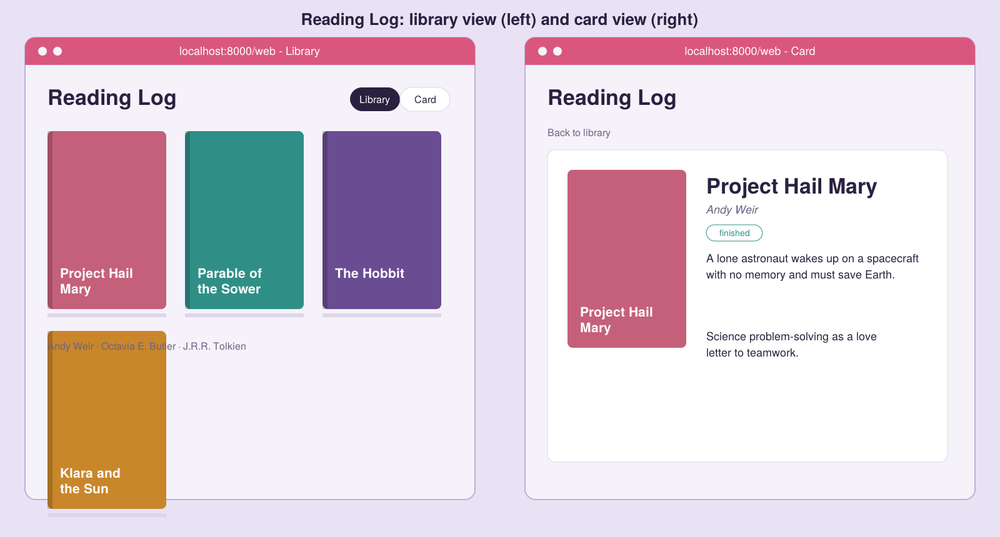

# Reading Log (MCP workshop project)

A personal book-report site powered by an MCP server. VS Code Copilot Chat searches Open Library
for covers and descriptions, saves books and reviews to `data/library.json`, and the
website shows them in a **Library view** (shelf of covers) and a **Card view**
(description, rating, review).



## How the pieces map to MCP
| MCP concept | In this repo |
|---|---|
| Tools | `search_books`, `get_book_details`, `add_to_library`, `save_review` |
| Resources | `library://books`, `library://books/{work_id}` |
| Prompts | `book_report` |

## Setup

### Prerequisites

You will need:

- Python 3.10 or newer
- Git
- VS Code
- GitHub Copilot Chat with MCP support enabled

### 1. Clone the repository

```bash
git clone https://github.com/liliana-cc/mcp-reading-log.git
cd mcp-reading-log
```

### 2. Create the Python environment

On macOS or Linux:

```bash
python3 -m venv .venv
source .venv/bin/activate
python -m pip install -r requirements.txt
```

On Windows PowerShell:

```powershell
py -m venv .venv
.venv\Scripts\Activate.ps1
python -m pip install -r requirements.txt
```

### 3. Configure the MCP server in VS Code

Open the repository folder in VS Code:

```bash
code .
```

Create `.vscode/mcp.json` with this content:

```json
{
  "servers": {
    "reading-log": {
      "type": "stdio",
      "command": "/absolute/path/to/mcp-reading-log/.venv/bin/python",
      "args": [
        "/absolute/path/to/mcp-reading-log/server/server.py"
      ]
    }
  }
}
```

Replace both `/absolute/path/to/mcp-reading-log` values with the absolute path to your cloned repository. On macOS or Linux, run `pwd` from the repository root to find that path.

On Windows, use the Python executable inside `.venv\Scripts\python.exe` and the full path to `server\server.py`.

The server path is `server/server.py`. There is no `reading-log` directory between the repository root and `server`.

### 4. Use the MCP server from VS Code Chat

Open Copilot Chat in VS Code and try:

> Search Open Library for “Klara and the Sun”. Show me the result, but do not add anything yet.

Then try:

> Add the matching book to my reading library and save a four-star review saying it is a thoughtful story about artificial intelligence and humanity.

The server provides these tools:

- `search_books` searches Open Library.
- `get_book_details` gets a book's description and subjects.
- `add_to_library` saves a book to the reading log.
- `save_review` saves a rating, review, and reading status.

Changes are stored in `data/library.json`.

If VS Code does not recognize the server, reload the window after creating `.vscode/mcp.json`, then check the MCP server controls in VS Code. You can use the Inspector fallback below to verify that the Python server itself works.

### 5. View the site

Start the static web server from the repository root:

```bash
python -m http.server 8000
```

Open [http://localhost:8000/web/](http://localhost:8000/web/) in a browser. Refresh the page after using Copilot Chat to add or update a book.

The site has two views:

- **Library** shows the books as a shelf of covers.
- **Card** shows a selected book's description, status, rating, and review.

Keep the web server running in its own terminal while using the MCP server in VS Code.

## MCP Inspector fallback

The Inspector lets you test the MCP server directly without VS Code Chat:

```bash
mcp dev server/server.py
```

Open the printed URL, then call `search_books` with:

```json
{"query": "Parable of the Sower"}
```

You can use the Inspector to call each tool manually and browse the `library://books` resource.

## Workshop exercises
1. Add a `remove_from_library` tool.
2. Add a `reading_stats` resource (books finished, average rating).
3. Add a `recommend_next` prompt that reads `library://books`.
4. Hackathon stretch: swap Open Library for any free API and keep the same tool shape.
